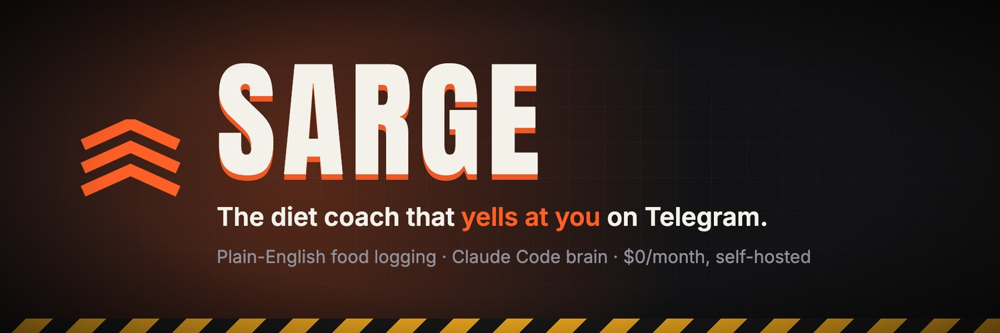
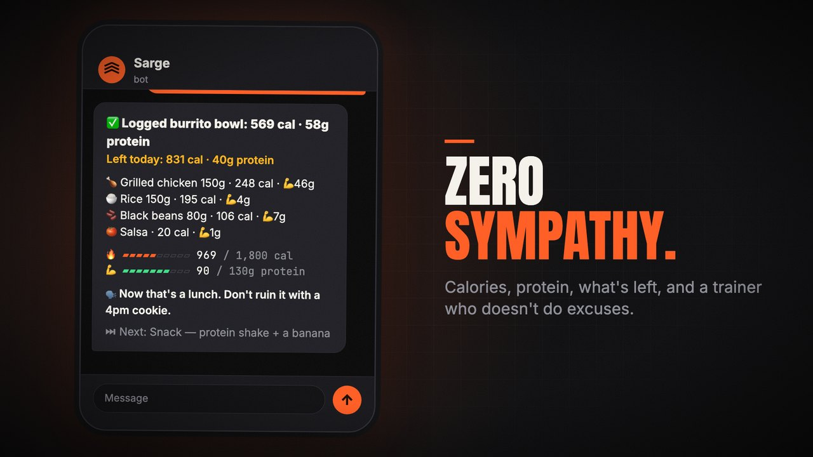
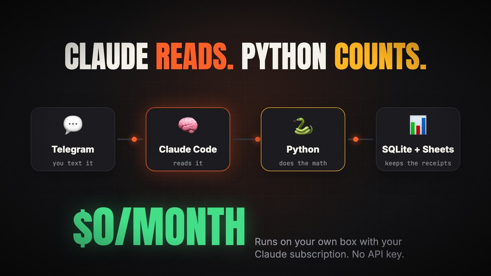
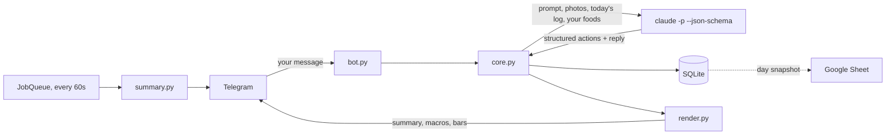

<p align="center">
  
</p>

<p align="center">
  
  
  
  
  
</p>

<p align="center">
  <b>You text it what you ate, in plain English.</b> Or send a photo of the label, the pack or your plate. It works out the calories and macros and tells you what's left for the day.<br>
  Claude reads your messages. Python does all the math. No sympathy included.
</p>

<p align="center">
  <a href="docs/demo.mp4"></a><br>
  <sub>▶ <a href="docs/demo.mp4"><b>Watch the 26-second demo</b></a> (sound on 🔊)</sub>
</p>

<table>
  <tr>
    <td width="50%"></td>
    <td width="50%"></td>
  </tr>
  <tr>
    <td align="center"><b>🍗 Log in plain English</b><br><sub>Exact calories and macros, plus what's left</sub></td>
    <td align="center"><b>🧠 Claude reads, 🐍 Python counts</b><br><sub>Self-hosted on your Claude subscription</sub></td>
  </tr>
</table>

## 💬 What a reply looks like

```
you    › [photo of a protein tortilla pack, label side]
         using two of these

sarge  › 📸 Reading your photos…

         📝 Draft Acme protein tortilla x2: 220 cal · 20g P · 28g C · 8g F
         🌯 Acme protein tortilla x2 · 220 cal · 💪20g

         Say "ate it" to log it, or correct me first.

you    › add 100g chicken, then ate it

sarge  › ✅ Logged tortilla wrap: 385 cal · 51g P · 28g C · 11g F
         Left today: 1,415 cal · 79g protein

         🌯 Acme protein tortilla x2 · 220 cal · 💪20g
         🍗 Grilled chicken 100g · 165 cal · 💪31g

         🔥 ▰▰▱▱▱▱▱▱▱▱ 385 / 1,800 cal
         💪 ▰▰▰▰▱▱▱▱▱▱ 51 / 130g protein

         🗣 Two items, one wrap, no excuses. Now go drink some water.
```

## ✨ What it does

- **Reads photos.** Send a nutrition label, a pack or a plate. Albums are read together, so a pack and its label count as one call. A photo makes a draft: nothing is logged until you reply "ate it" (or "ate half", or correct it first). Menu photos get the best 1-3 orders for what's left today.
- **Logs food from plain English.** "Chicken rice bowl, 150g chicken, 5g oil", "a handful of almonds", "that rice was 200g actually". Mixed dishes get split into their parts, and fixes edit the right item. Questions never log anything.
- **Remembers your products.** Read a label once and it keeps the brand, variant, serving size and exact macros. Next time, "two Acme tortillas" is scaled from the saved label, with no new estimate. Set a default when you have several versions of the same food. Use `/foods` to see what it knows.
- **Goals live in chat.** "New goal: 1500 cal, 100g protein" changes them for today onward, and `/goals` shows them. The `TARGET_*` values in `.env` are only the starting goals.
- **Only tells you what matters.** Every meal reply starts with one summary line: calories and all four macros, and what's left today. Chat that isn't food gets a short answer with no stats.
- **One night summary, no reminders.** Sarge never pings you during the day. Once a day (default 22:00) it sends a summary: what went well, where you slipped, one thing to fix tomorrow, with the day's numbers underneath. Change the time from chat: "send my summary at 11".
- **Tracks water, steps and vitamin D** too: "1L water", "9200 steps", "took vit D".
- **Can copy your log to a Google Sheet**: a Daily tab with one row per day, and a Log tab with every item.
- **Costs nothing to run.** The "brain" is [Claude Code](https://docs.anthropic.com/en/docs/claude-code) in headless mode, signed in with your existing Claude subscription. No API key, no paid servers. It runs on any always-on machine: a home server, a Raspberry Pi 5, an old laptop.

## ⚙️ How it works



The work is split so the numbers are always right:

- **Claude interprets.** It turns your text into structured actions: food items with macros, edits, deletions, water, steps, saved products and goal changes. It also writes the one-line trainer comment. The reply is checked against a JSON schema, and every item id is validated before it's applied.
- **Python enforces.** It stores everything, adds up the totals, draws the progress bars, and runs the night summary timer. Claude never states totals, so it can't get them wrong.

Photos go to a stronger model than text (`CLAUDE_PHOTO_MODEL`, default `opus`).

A "day" ends at 4am, so a midnight snack counts toward the day you ate it.

## 🚀 Setup

What you need:

- An always-on **Linux** machine. macOS works for trying it out.
- **Python 3.11+**
- A **Claude subscription** (Pro or Max) for Claude Code
- A **Telegram** account

### 1. Create the Telegram bot

1. In Telegram, message [@BotFather](https://t.me/BotFather) and send `/newbot`. Pick a name and a username.
2. Copy the **token** it gives you. It looks like `123456789:AA...`.
3. Message [@userinfobot](https://t.me/userinfobot) to get your numeric **user id**. Sarge only answers this id.

### 2. Install and sign in to Claude Code on the machine

```bash
curl -fsSL https://claude.ai/install.sh | bash   # or: npm install -g @anthropic-ai/claude-code
claude                                           # run once and sign in with your Claude account, then /exit
which claude                                     # note this absolute path, e.g. /home/you/.local/bin/claude
```

Check that headless mode works:

```bash
claude -p "say hi" --output-format json
```

### 3. Get the code

```bash
git clone https://github.com/Ishan-sa/sarge.git ~/sarge
cd ~/sarge
python3 -m venv .venv
.venv/bin/pip install -r requirements.txt
```

### 4. Configure

```bash
cp .env.example .env
chmod 600 .env
nano .env
```

Set at least these:

| Variable | What to put |
|---|---|
| `TELEGRAM_TOKEN` | The token from BotFather |
| `CLAUDE_BIN` | The absolute path from `which claude` |
| `OWNER_ID` | Your Telegram user id. If you leave it empty, the first person to send `/start` owns the bot. |
| `SARGE_USER_NAME` | Your name, as Sarge should use it |
| `SARGE_PRONOUNS` | `he` or `she`: how Sarge's prompts refer to you (default `he`) |

These are optional: `CLAUDE_MODEL` (default `sonnet`, used for text), `CLAUDE_PHOTO_MODEL` (default `opus`, used for photos; set it to `sonnet` if Opus is too slow for you), `SARGE_TZ` (default `America/Vancouver`), and `TARGET_KCAL`, `TARGET_PROTEIN`, `TARGET_WATER_ML`, `TARGET_STEPS`. The `TARGET_*` values are only your starting goals. After that, change them from chat.

**Put in your own diet plan.** `sarge/plan.py` holds an example plan. `PLAN_TEXT` is the plan in words, which Claude reads as food context and food rules (for example, vegetarian). You can edit that file directly, or copy it to `sarge/plan_local.py`, which is gitignored and used instead, so your plan stays private and `git pull` never conflicts.

### 5. Try it

```bash
.venv/bin/python -m sarge.bot
```

Send your bot `/start`, then something like `greek yogurt with berries and granola`, or a photo of a nutrition label. Stop it with `Ctrl+C` when you're done.

### 6. Keep it running (systemd)

```bash
mkdir -p ~/.config/systemd/user
cp deploy/sarge.service ~/.config/systemd/user/
systemctl --user daemon-reload
systemctl --user enable --now sarge
sudo loginctl enable-linger "$USER"      # keep running after you log out and after reboots

journalctl --user -u sarge -f            # live logs
```

The unit file assumes the code lives in `~/sarge`. If you put it somewhere else, change `WorkingDirectory` and `ExecStart`.

### 7. Optional: mirror to a Google Sheet

1. Create a new Google Sheet, then open **Extensions → Apps Script**.
2. Paste in the contents of [`deploy/sheet.gs`](deploy/sheet.gs).
3. Replace `__SHEET_SECRET__` with a long random string. `openssl rand -hex 24` makes one.
4. Click **Deploy → New deployment → Web app**. Set *Execute as: Me* and *Who has access: Anyone*, then authorize it.
5. Copy the web app URL, the one that ends in `/exec`. Add it and your secret to `.env`:
   ```
   SHEET_WEBHOOK_URL=https://script.google.com/macros/s/.../exec
   SHEET_SECRET=the-same-random-string
   ```
6. Run `systemctl --user restart sarge`. The **Daily** and **Log** tabs appear the first time you log something.

The sync sends a full copy of the day every time, so a failed push is fixed by the next one. If the sheet is down, logging still works.

## 🗣 Using it

| You send | Sarge does |
|---|---|
| `salmon, 200g potatoes, broccoli, 5g olive oil` | Logs the meal and replies with what's left today |
| 📸 a nutrition label or pack (several photos as one album are read together) | Reads it and drafts the meal. If you didn't say how much, it asks. |
| 📸 a photo of your plate | Estimates each item and drafts the meal |
| `ate it` / `ate half` | Logs the pending draft |
| 📸 a photo of a menu | Suggests what to order for what's left today |
| `that rice was 200g` / `remove the sauce` / `delete that` | Edits or deletes today's items |
| `Acme protein tortilla, 1 wrap (60g): 110 cal, 10g protein, 14g carbs, 4g fat` | Saves the label values for next time |
| `new goal: 1500 cal, 100g protein` | Changes your goals from today on |
| `send my summary at 11` | Moves the night summary to 11pm |
| `1L water` · `9200 steps` · `took vit D` | Tracks the extras |
| `what's left?` / `what should I eat?` | Shows the numbers and suggests what to eat |
| `/today` | Everything logged today |
| `/week` | A table of the last 7 days |
| `/undo` | Deletes the last entry |
| `/foods` | The products it remembers |
| `/goals` | Your goals and summary time |

### 🌙 The night summary

The only message Sarge sends on its own. It goes out once a day at your summary time (default 22:00, in `SARGE_TZ`): Claude writes what went well, where you slipped and one thing to fix tomorrow, and Python adds the exact numbers and your streak below it. If Claude fails, a built-in template is sent instead. A missed summary is sent when the bot comes back up.

## ⬆️ Upgrading from the original release

Version 1 changes how saved foods are stored, and drops the daily reminders of the original release (the reminder bot). Your history is kept.

1. Back up the database: `cp data/sarge.db data/sarge.db.bak`
2. Pull the new code and restart: `git pull && systemctl --user restart sarge`. On start, your old saved foods are converted automatically (the originals are kept in a `foods_v1` backup table).
3. Optional: fill in brands and serving sizes on the converted foods with `.venv/bin/python -m sarge.migrate_foods`. It asks Claude to parse each old description into label fields, never changes your macros, and is safe to re-run.

Also add `CLAUDE_PHOTO_MODEL` to your `.env` if you want to change the photo model.

## 🧪 Development

```bash
.venv/bin/pip install pytest
.venv/bin/python -m pytest -q
```

The tests use a fake brain and never call Claude.

The demo video's source is in [`demo/`](demo). It's made with Remotion, with a soundtrack synthesized in numpy.

```
sarge/
  bot.py        Telegram handlers, owner check, photo albums, 60 s summary tick
  brain.py      Claude Code headless calls, JSON schema, prompts and voice
  core.py       applies Claude's actions to the store (validated, today only)
  foods.py      label scaling
  goals.py      goal parsing and validation
  store.py      SQLite: entries, items, extras, saved foods, goals, messages, state
  render.py     every message layout (HTML): summary line, macros, bars
  summary.py    decides when the night summary is due and what it says
  migrate_foods.py  one-off converter for saved foods from the original release
  sheets.py     Google Sheet mirror client
  plan.py       example diet plan (override in plan_local.py)
  config.py     starting goals, env loading
deploy/
  sarge.service systemd user unit
  sheet.gs      Apps Script web app for the sheet mirror
```

## 🩺 Troubleshooting

- **The bot doesn't answer.** Run `journalctl --user -u sarge -f`. A line like `ignoring update from user X (owner is Y)` means `OWNER_ID` is wrong.
- **"⚠️ Brain failed".** Run `$CLAUDE_BIN -p hi` as the same user the service runs as. You may need to sign in again. If photos time out, set `CLAUDE_PHOTO_MODEL=sonnet`.
- **`claude: command not found` over SSH.** Non-login shells often don't have `~/.local/bin` on `PATH`. That's why `CLAUDE_BIN` is an absolute path.
- **The sheet doesn't update.** Look for `sheet sync failed` in the logs. After you edit `sheet.gs`, deploy a new version: Deploy → Manage deployments → Edit → New version.

## 🔒 Privacy

Everything stays on your machine (SQLite in `data/`), except:
- your messages, which go to Claude through your own Claude Code login
- your log, which goes to your own Google Sheet, if you turn that on

`.env` and `data/` are gitignored.

## 📄 License

[MIT](LICENSE)
